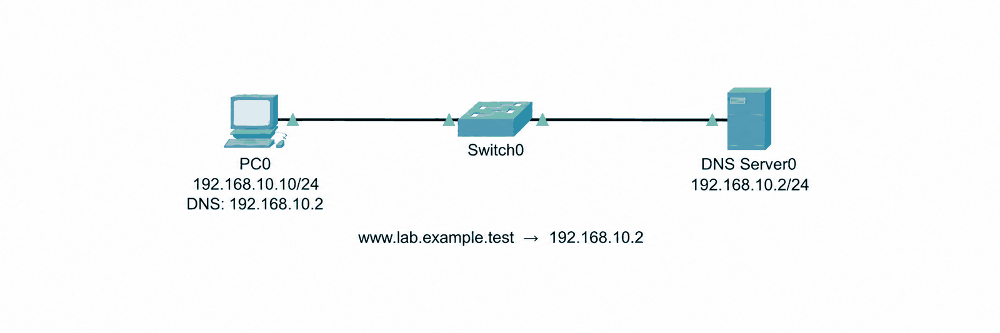
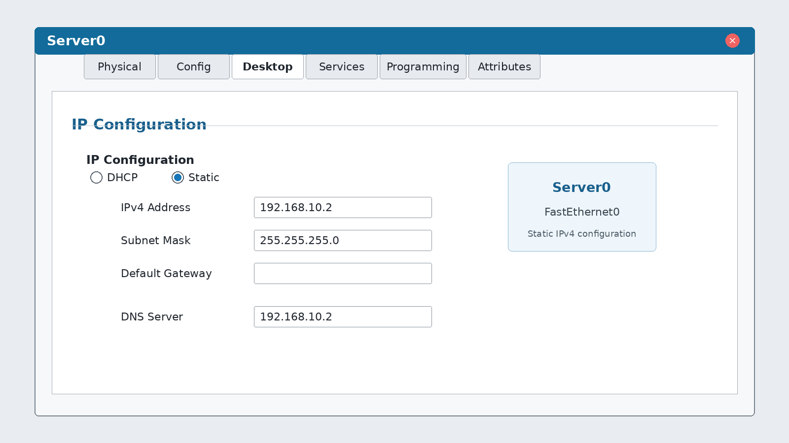
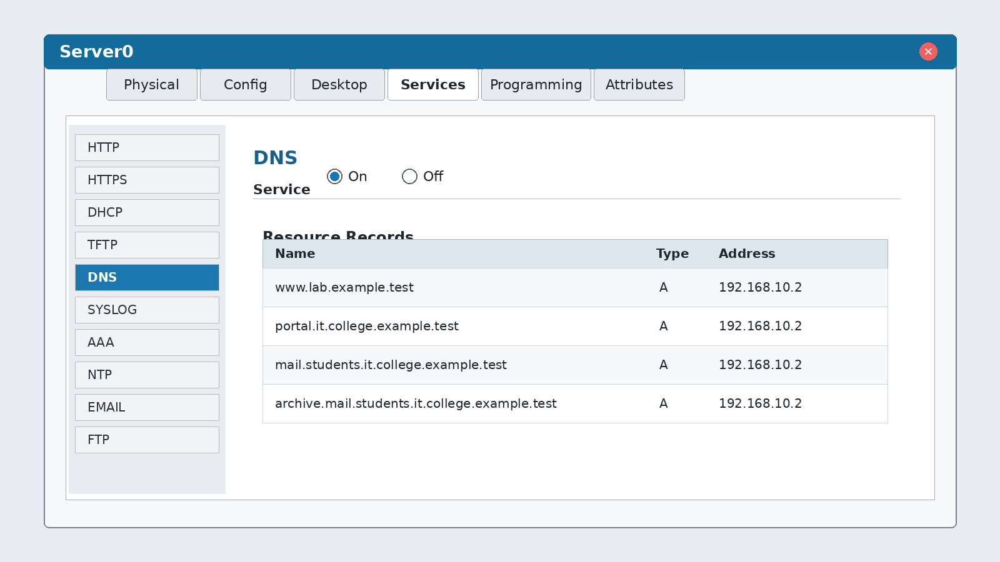
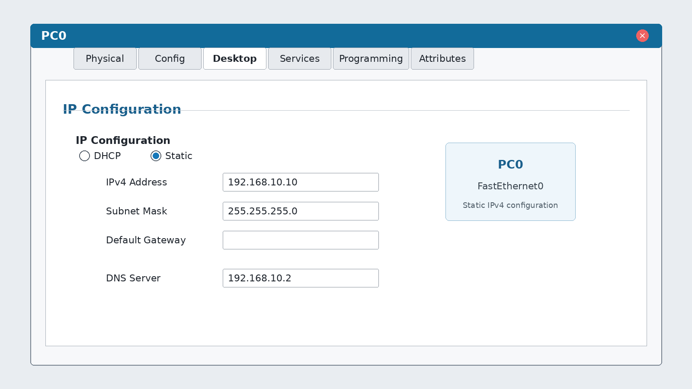
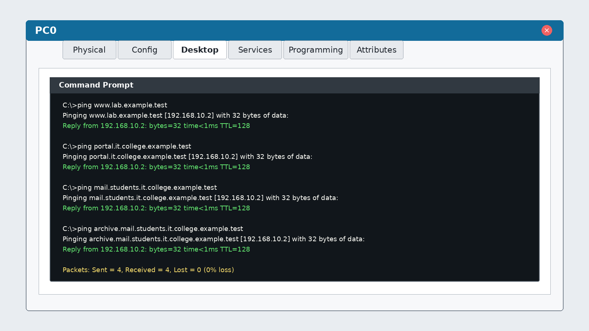

# Настройка DNS-сервера в Cisco Packet Tracer

## Схема сети

В локальной сети используются один компьютер, коммутатор и DNS-сервер.

## Адресация

| Устройство | IPv4-адрес | Маска | DNS-сервер |
|---|---|---|---|
| Server0 | `192.168.10.2` | `255.255.255.0` | `192.168.10.2` |
| PC0 | `192.168.10.10` | `255.255.255.0` | `192.168.10.2` |

### Настройка Server0

## Записи DNS

На Server0 в разделе **Services → DNS** служба переведена в состояние **On**. Добавлены записи типа `A`:

| Доменное имя | Число уровней | IP-адрес |
|---|---:|---|
| `www.lab.example.test` | 4 | `192.168.10.2` |
| `portal.it.college.example.test` | 5 | `192.168.10.2` |
| `mail.students.it.college.example.test` | 6 | `192.168.10.2` |
| `archive.mail.students.it.college.example.test` | 7 | `192.168.10.2` |

Уровни домена считают справа налево. Например, имя `portal.it.college.example.test` включает уровни `test`, `example`, `college`, `it` и `portal`.

## Настройка клиента

На PC0 указан DNS-сервер `192.168.10.2`.

## Проверка работы

Команда `ping` разрешает все доменные имена в адрес `192.168.10.2`. Получены ответы без потерь.

