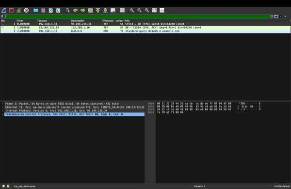
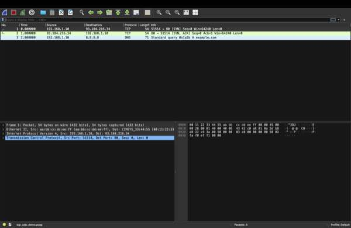
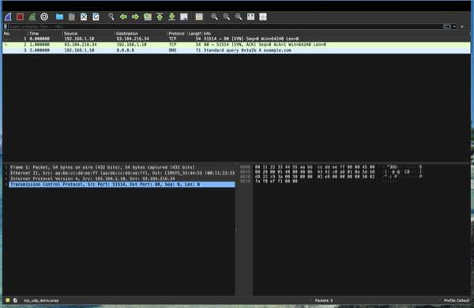

# Анализ TCP и UDP в Wireshark

## Цель работы

Рассмотреть пакеты TCP с разными флагами и UDP-пакет в программе Wireshark.

## Результат

В захвате показаны три пакета:

1. TCP-пакет с флагом `SYN` — начало установления соединения.
2. TCP-пакет с флагами `SYN, ACK` — ответ на запрос соединения.
3. UDP-пакет DNS — запрос к серверу `8.8.8.8` на порт `53`.

## Скриншоты

### TCP: SYN

### TCP: SYN, ACK

### UDP: DNS-запрос

