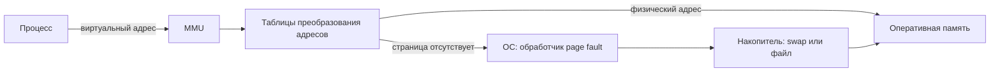
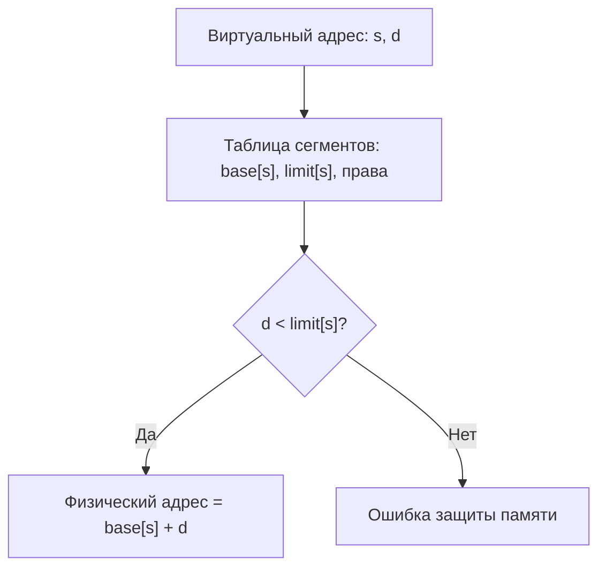
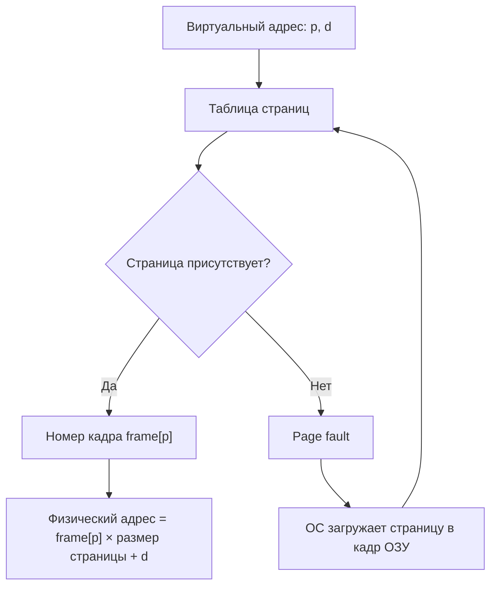
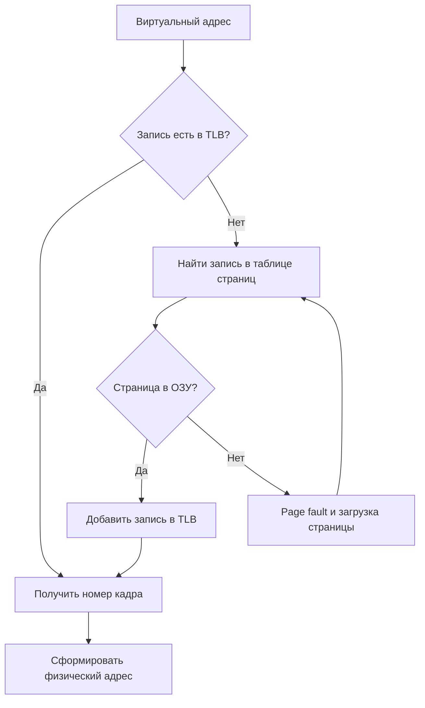
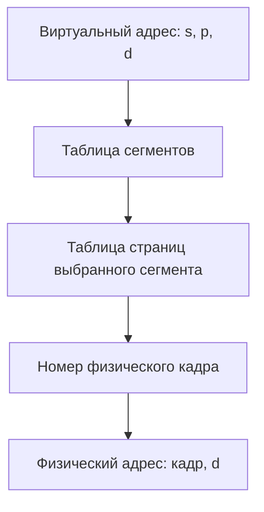

# Виртуальная память: сегментная и страничная архитектуры

## 1. Что такое виртуальная память

**Виртуальная память** — механизм операционной системы и процессора, при котором программа обращается к виртуальным адресам, а не напрямую к ячейкам оперативной памяти. Блок управления памятью процессора, MMU, переводит виртуальный адрес в физический адрес ОЗУ.

Виртуальная память решает несколько задач:

- изолирует процессы друг от друга;
- защищает код и данные процесса от несанкционированного доступа;
- даёт каждому процессу своё адресное пространство;
- позволяет загружать в ОЗУ только нужные части программы;
- использует накопитель как более медленное дополнительное хранилище при нехватке ОЗУ.

> **Важно:** виртуальная память не равна файлу подкачки. Файл подкачки или swap-раздел — только одно из средств хранения страниц, временно отсутствующих в ОЗУ.

### Основные термины

| Термин | Значение |
|---|---|
| Виртуальный адрес | Адрес, сформированный программой или процессором |
| Физический адрес | Адрес реальной ячейки оперативной памяти |
| MMU | Аппаратный блок, переводящий виртуальные адреса в физические |
| Таблица адресов | Структура данных ОС для преобразования адресов |
| Page fault | Событие, когда нужной страницы нет в оперативной памяти |
| Подкачка | Загрузка страницы с накопителя в ОЗУ или её выгрузка из ОЗУ |

## 2. Общая схема работы



1. Процессор получает виртуальный адрес от выполняемой программы.
2. MMU ищет сведения о нём в таблице сегментов или страниц.
3. При успешном поиске MMU формирует физический адрес и выполняет обращение к ОЗУ.
4. Если нужной страницы нет в ОЗУ, процессор вызывает исключение page fault.
5. ОС загружает страницу с накопителя в свободный кадр или вытесняет другую страницу, затем повторяет обращение.

## 3. Сегментная архитектура

При **сегментации** программа делится на логические части переменного размера: сегменты. Обычно отдельными сегментами служат код программы, глобальные данные, стек, куча и модули программы.

Виртуальный адрес состоит из номера сегмента и смещения внутри сегмента:

```text
+-----------------------+---------------------------+
| Номер сегмента s      | Смещение в сегменте d     |
+-----------------------+---------------------------+
```

Для каждого сегмента таблица сегментов содержит:

- базовый физический адрес, `base[s]`;
- размер сегмента, `limit[s]`;
- права доступа: чтение, запись, выполнение;
- при необходимости дополнительные признаки, например присутствие в памяти.

### Схема преобразования адреса



### Пример

Пусть для сегмента № 2:

```text
base[2] = 12000
limit[2] = 4000 байт
виртуальный адрес: сегмент 2, смещение 500
```

Смещение допустимо, так как `500 < 4000`. Физический адрес:

```text
12000 + 500 = 12500
```

Если программа обратится к смещению 4500, она выйдет за границу сегмента. MMU должна запретить такое обращение.

### Преимущества сегментации

- Логическая структура памяти соответствует структуре программы.
- Для кода, данных и стека можно задать разные права доступа.
- Отдельные сегменты можно разделять между процессами, например сегмент кода общей библиотеки.
- Легко проверять выход за границы логического блока.

### Недостатки сегментации

- Сегменты имеют разный размер, поэтому в памяти возникает внешняя фрагментация.
- Для размещения сегмента нужен непрерывный участок памяти нужного размера.
- Может потребоваться компактизация: перенос сегментов для объединения свободного пространства.
- Управление памятью сложнее, чем при одинаковых блоках.

## 4. Страничная архитектура

При **страничной организации** виртуальное адресное пространство делится на страницы одинакового размера, а физическая память — на кадры такого же размера. Например, распространённый размер страницы — 4 КиБ.

Виртуальная страница может находиться в любом свободном физическом кадре. Страницы одного процесса не обязаны лежать в ОЗУ подряд.

Виртуальный адрес состоит из номера страницы и смещения:

```text
+-------------------------+-----------------------------+
| Номер страницы p        | Смещение внутри страницы d  |
+-------------------------+-----------------------------+
```

Таблица страниц для каждой виртуальной страницы обычно хранит:

- номер физического кадра;
- бит присутствия в ОЗУ;
- права чтения, записи и выполнения;
- бит обращения;
- бит изменения, или dirty bit.

### Схема преобразования адреса



### Пример

Пусть размер страницы равен 4096 байт, номер виртуальной страницы — 7, смещение — 300 байт, а таблица страниц содержит:

```text
page[7] = кадр 14
```

Тогда физический адрес равен:

```text
14 × 4096 + 300 = 57644
```

### Размещение страниц

```text
Виртуальное адресное пространство       Физическая память

Страница 0  ------------------------->  Кадр 5
Страница 1  ------------------------->  Кадр 12
Страница 2  ------------------------->  Кадр 1
Страница 3  ------------------------->  отсутствует в ОЗУ
Страница 4  ------------------------->  Кадр 8
```

### TLB

**TLB**, Translation Lookaside Buffer, — быстрый кэш недавних преобразований «номер виртуальной страницы → номер физического кадра». Он уменьшает число обращений к таблице страниц в памяти.



### Преимущества страничной организации

- Нет внешней фрагментации.
- Процесс не требует непрерывного участка физической памяти.
- Одинаковые кадры легко выделять и освобождать.
- Страницы удобно загружать по требованию и выгружать при нехватке памяти.
- Поддерживаются защита памяти и совместное использование страниц.

### Недостатки страничной организации

- Возможна внутренняя фрагментация: последняя страница процесса может быть заполнена не полностью.
- Большим адресным пространствам требуются большие или многоуровневые таблицы страниц.
- Page fault значительно медленнее обычного обращения к ОЗУ.
- Частая подкачка приводит к thrashing: процесс много времени тратит на обмен страницами с накопителем.

## 5. Сегментно-страничная архитектура

Сегментацию и страничную организацию можно сочетать. Сначала программа разделяется на логические сегменты, затем каждый сегмент — на страницы фиксированного размера.

```text
+----------------+----------------+---------------------------+
| Сегмент s      | Страница p     | Смещение d                |
+----------------+----------------+---------------------------+
```



Этот подход сохраняет логическое деление программы на сегменты и уменьшает проблему внешней фрагментации, потому что сегменты состоят из страниц одинакового размера.

## 6. Сравнение архитектур

| Характеристика | Сегментация | Страничная организация |
|---|---|---|
| Единица выделения | Сегмент | Страница |
| Размер блока | Переменный | Фиксированный |
| Логическая структура программы | Учитывается | Обычно не учитывается |
| Внешняя фрагментация | Возможна | Отсутствует |
| Внутренняя фрагментация | Обычно небольшая | Возможна в последней странице |
| Размещение в ОЗУ | Требуется непрерывный участок для сегмента | Страницы размещаются в любых кадрах |
| Основная таблица | Таблица сегментов | Таблица страниц |
| Подкачка | Возможна | Основной и удобный механизм |

## 7. Вывод

Сегментация делит память по смыслу программы: код, данные, стек и другие части. Страничная организация делит память на равные блоки, которые можно размещать в разных кадрах ОЗУ. Современные системы главным образом используют страничную виртуальную память, поскольку она упрощает изоляцию процессов, защиту памяти и подкачку.